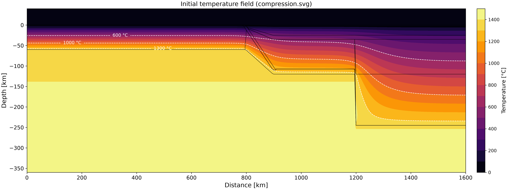
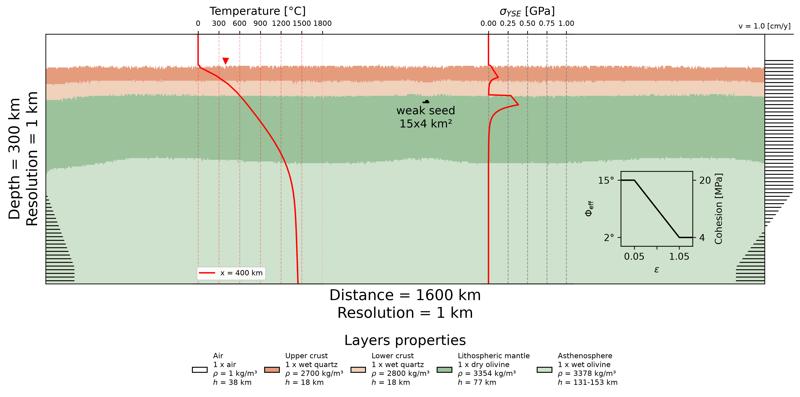

# Introduction

## What tapIOca is

tapIOca (package `tapioca-mandyoc`) is a set of Python tools to prepare and analyse models of [Mandyoc](https://github.com/ggciag/mandyoc), the finite element code that simulates the thermomechanical evolution of the lithosphere and the mantle. It covers both ends of a model:

- **before the run**: it creates the input files of Mandyoc (`interfaces.txt`, `param.txt`, `input_temperature_0.txt`, `input_velocity_0.txt` and the files of conditions that change in time), from a Python script or from a scenario drawn in an SVG file;
- **after the run**: it converts the outputs into NetCDF files and organizes them in a navigable data structure (`xarray.DataTree`), with post-processing functions such as the deviatoric stress tensor and the selection of particles.

tapIOca links the drawing of a scenario to the final figures. The same scenario can be run with the C++ Mandyoc or with mandyocjll, the port of Mandyoc to Julia: the input files are the same.

## The parts of the package

| Part | What it does |
|---|---|
| `tapioca.inputs` | generic builders: geometry, materials, temperature, velocity and conditions in time |
| `tapioca.inputs.svg` | scenarios drawn in SVG (Inkscape) and the tools `tapioca-svg`, `tapioca-svg-interfaces` and `tapioca-svg-from-state` |
| `tapioca.scenClasses` | `MandyocScen`: the outputs (`.nc`) read into a `DataTree` |
| `tapioca.post_processing` | the `postproc` accessor of the `DataTree`, with computations on the results |
| `src/postrunning` | scripts that organize the outputs and convert them to NetCDF (Julia and Python) |
| `examples/` | example SVG scenarios, the classical examples of Mandyoc as SVGs and a finished run |

## How to read this handbook

Chapters 2 to 4 cover the installation, the workflow and the conventions, for everyone. Chapter 5 teaches how to draw and build an SVG scenario, and chapter 6 shows how this works inside. Chapter 7 covers the generic builders, used from scripts. Chapters 8 and 9 cover running and post-processing. Chapter 10 is the guide for those who will change the code.

# Installation

The SVG scenarios and the run scripts are in the fork [jopmas/tapioca](https://github.com/jopmas/tapioca), branch `feat/svg-scenario-inputs`, not yet merged into [ggciag/tapioca](https://github.com/ggciag/tapioca):

```bash
git clone -b feat/svg-scenario-inputs https://github.com/jopmas/tapioca.git ~/opt/tapioca
cd ~/opt/tapioca
conda env create -f environment.yml -y     # environment "tapioca", with fixed versions
conda activate tapioca
pip install -e ".[test]"
pytest                                       # about 30 s
```

`environment.yml` fixes the versions of the libraries, so that a new release of one of them does not change the results. It also brings PETSc and OpenMPI, to build and run Mandyoc in the same environment, and `poppler` and `pypdf`, to read PDF reports.

The SVG scenarios are read as **SVG 1.1 saved by Inkscape 1.4**. Inkscape is not installed by `environment.yml`: install it from [inkscape.org](https://inkscape.org). A file of another version is read with a warning.

The run scripts written by tapIOca look for tapIOca in `~/opt/tapioca` and for the figure scripts of the group in `~/opt/post_processing` (variables `TAPIOCA_DIR` and `POST_PROCESSING_DIR`).

# The workflow

A scenario goes through the steps below. The dashed boxes are optional.

```latex
\begin{center}
\begin{tikzpicture}[node distance=4.5mm, every node/.style={font=\small},
  box/.style={draw, rounded corners, fill=blue!6, minimum width=9.6cm, minimum height=7mm, align=center},
  opt/.style={draw, rounded corners, dashed, fill=orange!8, minimum width=9.6cm, minimum height=7mm, align=center}]
\node[box] (a) {drawing of the scenario in Inkscape (\texttt{scenario.svg}) \quad or \quad script with the generic builders};
\node[box, below=of a] (b) {\texttt{tapioca-svg}: inputs of Mandyoc, figures of the scenario and run script};
\node[box, below=of b] (c) {run: Mandyoc (C++) or mandyocjll (Julia), on a computer or on Hypatia};
\node[box, below=of c] (d) {outputs as text files (Mandyoc) or zarr stores (mandyocjll and Mandyoc with \texttt{zarr\_output})};
\node[box, below=of d] (e) {\texttt{src/postrunning}: \texttt{.nc} files (\texttt{meshes2netcdf.jl}, \texttt{zarr2netcdf.py})};
\node[opt, below=of e] (f) {snapshots and video (\texttt{post\_processing}) and zip of the scenario};
\node[box, below=of f] (g) {\texttt{MandyocScen}: \texttt{DataTree} with meshes, surface and particles; \texttt{postproc}};
\foreach \u/\v in {a/b,b/c,c/d,d/e,e/f,f/g} \draw[-{Stealth}] (\u) -- (\v);
\end{tikzpicture}
\end{center}
```

The run script written by `tapioca-svg` does every step from the run on by itself: it runs the code, converts the outputs, makes the figures and zips the scenario.

# Conventions

- **Grid**: $z$ is positive upwards, from $-L_z$ at the base to 0 at the top; node $(i, j) = (0, 0)$ is the bottom-left corner. The SVG reader works with depths positive downwards (as the drawing) and converts them in `layers_to_builder`.
- **Interfaces**: interface `i` is the top of layer `i` and carries its material; ID `-1` is the top layer (the sticky air).
- **Materials**: `interfaces.txt` has 13 parameters per layer: `C` (viscosity scale factor), `rho` (density), `H` (radiogenic heat, W/kg), `A`, `n`, `Q`, `V` (flow law), `k` (diffusivity), `weakening_seed`, `cohesion_min`, `cohesion_max`, `friction_angle_min` and `friction_angle_max`. The reference materials are in `tapioca.DEFAULT_MATERIALS`: `wet olivine`, `dry olivine`, `wet quartz`, `wet anorthite`, `linear salt`, `dry quartz`, `basalt`, `plagioclase` and `air`.
- **Weak zone**: the layer of the weak seed has `weakening_seed = 1`; the others, `-1`.
- **Units**: `SEC_PER_YEAR` uses 365.25 days. The settings accept units (km or m; Myr, kyr or yr; cm/yr or mm/yr; °C), defined in `tapioca.UNITS`.
- **Initial temperature**: steady-state conduction in the lithosphere, with the base of the lithosphere (LAB) at 1350 °C and the mantle adiabat below it.
- **Water and magmatic layers**: chosen by the user (`water_layer`, `magmatic_layer`), never guessed from their position.

# Scenarios drawn in SVG

## The idea

A scenario is drawn as a vertical section of the lithosphere, in Inkscape. Each filled shape is a body of rock; the object properties (label, title and description) give its material. A special shape, the `setup`, gives the size of the domain, the resolution and the numerical experiment. `tapioca-svg` reads the drawing and creates every input of Mandyoc:

```bash
tapioca-svg scenario.svg -o my_scenario
```

or, in Python:

```python
from tapioca.inputs.svg import SVGScenario
SVGScenario("scenario.svg").write_all("my_scenario")
```


## Units of rock

Each filled shape is described by its object properties in Inkscape (*Object > Object Properties*):

- **Label**: name of the unit. Shapes with the same label are the same unit.
- **Title**: name of the unit in the legend of the figures (optional).
- **Description**: the reference material in the first line, and the properties in the next lines:

```
wet quartz
C = 1.0
rho = 2800.0
H = 0.19e-6 / 2800.0
h = 10 km
```

`C`, `rho` and `H` are required. The other parameters (`A`, `n`, `Q`, `V`, `k`, `weakening_seed`, cohesion and friction) are optional and, when missing, come from the reference material. A shape without a description inherits the one of the group that contains it (e.g. an Inkscape layer); shapes without any description (arrows, annotations) are ignored. The fill colour is used in the figures.

The shapes are painted in document order, as Inkscape shows them: a simple way to draw is a rectangle of asthenosphere over the whole domain and the other units on top of it. Two labels are special: `asthenosphere` (the bottom unit) and `weak_seed` (weak zones, with initial strain 1). The top unit must be the sticky air.

Points not covered by any shape (thin gaps, shapes that stop short of a side) take the unit of the nearest covered point, with a warning. Thin layers left by overlapping shapes (thinner than `min_thickness`, 1 km by default) are removed, also with a warning.

## Thickness of the units (`h`)

The drawing does not need to be in vertical scale: `h` gives the reference thickness of a unit.

- **Layers** (units that reach both sides of the domain): the most common drawn thickness becomes `h`, and the same factor applies to every column, so thinned regions keep their drawn proportion.
- **Bodies** (seeds, basins, keels): without `h`, they follow the scaling of the unit they are drawn over; with `h`, they get that thickness, and the unit around them absorbs the difference.
- The **bottom unit** (asthenosphere) fills the rest of the domain and can not have `h`.

## The domain and the numerical experiment

The shape labelled `setup` (e.g. a rectangle without fill) gives the domain: its bounding box is mapped to the domain, and its description gives the dimensions, the resolution and the experiment:

```
Lx = 1600 km
Lz = 300 km
dx = 2 km
dz = 2 km
regime = rifting
velocity = 1 cm/yr
moving_boundary = right
time_max = 60 Myr
magmatism = off
code = mandyoc
```

Every setting can also be given on the command line (e.g. `--regime`, `--dx`) or as an argument of `SVGScenario`, and then replaces the one of the SVG. The main ones:

| Setting | Default | |
|---|---|---|
| `regime` | `rifting` | `rifting` (extension), `compression`, `accordion` or `quiescence` |
| `velocity` | 1 cm/yr | velocity of the moving boundary (with `symmetric`, the sum of both boundaries) |
| `moving_boundary` | `right` | `left`, `right` or `symmetric` |
| `time_max` | 60 Myr | duration of the simulation |
| `quiescence_time` | 0 Myr | `accordion` and `quiescence` regimes |
| `magmatism`, `magmatism_extraction`, `magmatism_Ts0` | `off`, `off`, 1080 °C | melting in Mandyoc and extraction of the melt |
| `heat_capacity`, `thermal_expansion_coefficient`, `gravity_acceleration` | 1250, 3.28e-5, 10 | used in `param.txt` and in the initial temperature |
| `water_layer`, `magmatic_layer` | none, basalt at the top | water and magmatic layers (label or ID) |
| `preset_initial_temperature`, `preset_temperature_mode` | none, `profile` | temperature of a preliminary scenario |
| `custom_veloc_field` | none | Python script that builds the velocity |
| `custom_temp_field` | none | Python script that changes the initial temperature (plume, hot base, ...) |
| `temperature_solver` | `2D` | `2D` (whole lithosphere) or `columns` (each column) |
| `code` | `mandyoc` | code called by the run script: `mandyoc` or `mandyocjll` |
| `min_thickness`, `sampling` | 1 km, 100 m | thin layers removed; vertical sampling of the drawing |

Keys of the `param.txt` of Mandyoc that are not settings of the experiment (e.g. `particles_per_element`) may also go in the description of the `setup` and are copied to `param.txt`. Unknown settings and invalid values are errors (`SVGInputError`), with a message that names the problem.

## The regimes

- **rifting**: the moving boundary moves away with `velocity`; the velocity is constant from the surface down to 20 km below the thickest lithosphere, and a return flow below it balances the inflow and the outflow.
- **compression**: the moving boundary moves in; the velocity is constant down to 20 km below the lithosphere at the moving boundary, and the opposite boundary is fixed.
- **accordion**: extension until 25 Myr, convergence until 75 Myr, quiescence during `quiescence_time` and extension again (`scale_bcv.txt`), as in the M300 experiments.
- **quiescence**: fixed boundaries, to study the thermal evolution.

With `moving_boundary = symmetric`, both boundaries move with half of the velocity, each with its own return flow.





## Custom velocity field

`custom_veloc_field` points to a Python script that defines `build_velocity(scenario)`: it sets the boundary velocities with a `VelocityFieldBuilder` and returns it. The script has the whole `SVGScenario` (regime, velocity, surface, thickness of the lithosphere). The net flux through the boundaries must be zero (e.g. with `conservate_veloc`); otherwise tapIOca warns.

## Initial temperature

Without `preset_initial_temperature`, the initial temperature is the steady-state conduction in the lithosphere, from 0 °C at the surface to 1350 °C at the LAB, with the conductivity and the radiogenic heat of each unit, and the mantle adiabat below the LAB. With `temperature_solver = 2D` (default), the whole lithosphere is solved at once, so heat also flows sideways where the lithosphere changes thickness.

With `preset_initial_temperature` (the folder of a preliminary scenario), the initial temperature comes from the final state of that scenario:

- `preset_temperature_mode = profile` (default): the horizontal mean of the final temperature, adapted to the lithosphere of each column of the new scenario;
- `preset_temperature_mode = field`: the 2D field of the final temperature, interpolated on the grid (the domain must be the same).


## Custom temperature

`custom_temp_field` points to a Python script that defines `build_temperature(scenario)` (on the command line, `--custom-temp-field`). The script receives the scenario with the initial temperature already built (conduction, preset or isothermal) in `scenario.temperature_builder`, changes it and returns the builder. As in `custom_veloc_field`, `infos(scenario)` and `write_files(scenario, output_dir)` are optional, and the script is copied to the folder of the scenario and zipped in `inputs_<folder>.zip`. Both scripts may be used together.

`TemperatureFieldBuilder` has three methods for the usual anomalies (z positive upwards: `-Lz` at the base and 0 at the top of the domain). None of them changes the sticky air:

| Method | Anomaly |
|---|---|
| `add_thermal_anomaly(dT, x0, z0, rx, rz=None)` | ellipse centred at (x0, z0), e.g. a hot or cold blob |
| `add_plume(dT, x0, z_head, head_radius, head_rz=None, tail_radius=None, z_base=None)` | head centred at (x0, z_head) and a tail from `z_base` (default: the base) up to the head |
| `add_basal_anomaly(dT, thickness, x0=None, width=None)` | hot (or cold) layer at the base, along the whole base or around x0 |

All of them take `shape` (`gaussian`, the default; `cosine`, which is zero outside the radii; or `tophat`, with sharp edges) and `mode` (`add` adds `dT`; `set` takes the anomaly to the temperature `dT`). Mandyoc usually keeps the temperature of the base at its initial value, so a basal anomaly also heats the mantle from below during the run.

The `plume` example (`examples/svg_scenarios/plume/build_temp.py`) puts a plume 250 °C hotter than the mantle at the centre of the domain:

```python
def build_temperature(scenario):
    t = scenario.temperature_builder                     # temperature already built
    z_surface = -float(scenario.thickness_sa.max())      # base of the sticky air (z positive upwards)
    t.add_plume(250.0, x0=scenario.Lx / 2, z_head=z_surface - 300e3,
                head_radius=80e3, tail_radius=25e3)
    return t

def infos(scenario):                                     # optional: lines of infos_<folder>.txt
    return ["plume at the centre of the domain"]
```


## Sedimentation, water and magma

With `sp_surface_processes = True` and a sedimentation mode (`sp_mode = theunissen_sedimentation` or `sedimentation_rate_limited`), tapIOca adds one layer of sediments of zero thickness for each interval `dt_sed` between `ti_sed` and `tf_sed`, and writes `sediment_layers.txt`, `sedimentation_rate.txt` and `base_level.txt` (or `SP_vc.txt`, with `--sp-format SP_vc`). The sediments, the water and the extrusive basalt are drawn once, as templates below the domain: their shapes only give the material of the layers.


`water_layer` gives the unit drawn as water, right below the air. With `magmatism` and `magmatism_extraction` on, a basalt layer of zero thickness is added at the top of the solid layers, unless `magmatic_layer` gives another one.

## The examples

The examples are in `examples/svg_scenarios` (one per experiment) and `examples/classical_examples` (the examples of Mandyoc drawn in SVG):

| Folder | Scenario | Experiment |
|---|---|---|
| `rifting` | continental lithosphere (155 km) with a weak seed | rifting, 1 cm/yr, magmatism |
| `rifting_symmetric` | the same, with the seed at the centre | symmetric rifting |
| `rifting_with_basin` | lithosphere thinned below a sedimentary basin | rifting, 1 cm/yr |
| `compression` | oceanic lithosphere, margin, non-cratonic lithosphere and craton | compression, 1 cm/yr |
| `accordion` | non-cratonic lithosphere between two cratons | accordion |
| `quiescence` | cratonic keel in a 4000 km domain | quiescence, 1000 Myr |
| `rifting_sedimentation` | crust thicker at the centre | symmetric rifting with sedimentation |
| `plume` | 155 km continental lithosphere above a plume, in a 700 km deep domain | quiescence, 50 Myr, plume of `build_temp.py` (`custom_temp_field`) |

```bash
cd examples/svg_scenarios/rifting
tapioca-svg rifting.svg -o inputs                         # resolution of the SVG
tapioca-svg rifting.svg -o inputs --dx 5 --dz 5           # coarser grid, to test
```


## Starting from the final state of a simulation

`tapioca-svg-from-state` turns the final state of a finished run (`lithology.nc`, `temperature.nc` and `interfaces.txt`) into a new SVG: the lithology is rasterized and each unit becomes an SVG path, with its parameters in the description. The `setup` of the new SVG points to the temperature of the same state (`preset_temperature_mode = field`):

```bash
tapioca-svg-from-state path/to/scenario -o final_state.svg
tapioca-svg final_state.svg -o inputs
```

The SVG can be edited in Inkscape before building the new scenario (e.g. to change the regime or add a unit). The accumulated strain and the melt of the state are not kept.




## Only the interfaces

```bash
tapioca-svg-interfaces scenario.svg -o interfaces.txt --plot layers.png
```

writes only `interfaces.txt` and a figure of the layers, useful to check a drawing.

# How tapioca-svg works

## Classes

`SVGScenario` (`inputs/svg/scenario.py`) reads the settings (argument > SVG > default), chooses the water and magmatic layers and drives the generic builders. The reader (`inputs/svg/reader.py`) is a module of functions that turns the drawing into a stack of layers (`MandyocLayer`, with its material in a `LithologicalUnit`, in `inputs/svg/materials.py`). The checks are in `SVGChecks` (`inputs/checks.py`), which raises `SVGInputError` with a message that names the parameter.

| Class or module | Role |
|---|---|
| `SVGScenario` | settings, special layers, temperature, velocity and writing of the files |
| `reader` | from the drawing to the stack of layers |
| `MandyocLayer`, `LithologicalUnit` | a layer of the stack and its material |
| `SVGChecks` | checks of the settings and of the drawing |
| `MandyocBuilder` | interfaces, material fields, `param.txt` and export of the files |
| `TemperatureFieldBuilder` | initial temperature (`solve_heat_2D`, `solve_heat_1D`) |
| `VelocityFieldBuilder` | boundary velocities (`set_kinematic_regime`, `conservate_veloc`) |

## From the drawing to the stack of layers

1. **Shapes to sample points** (`read_units`, `rasterize`): the properties of each shape are read, the box of the `setup` is mapped to the domain and the drawing is sampled in `Nx` columns and rows of 100 m, painting the shapes in document order.
2. **Gaps and thin layers** (`fill_gaps`, `remove_slivers`): points without a shape take the nearest unit, and thin layers left by overlaps are removed.
3. **Columns to one stack** (`build_stack`): each interface of Mandyoc is a single line $z(x)$, so a single sequence of layers must fit every column. The sequences of the columns are joined by their shortest common supersequence: e.g. `[asthenosphere, mantle, crust, air]` and `[asthenosphere, mantle, crust, seed, crust, air]` give the second one, with zero thickness for the seed and for the slot of upper crust where they are absent.
4. **Thickness** (`rescale_thickness`): each unit with `h` is stretched to that thickness; bodies without `h` follow the unit they are in.
5. **Stack to builders** (`layers_to_builder`): the interfaces of the `MandyocBuilder` are created, the material fields are filled, and the temperature and velocity builders add their fields.

The surface is the top of the solid layers (the base of the air, or of the water). The LAB is found column by column: going down from the surface, the top of the first slot of asthenosphere with some thickness.

# Generic builders

The builders of `tapioca.inputs` can be used directly from a script, without an SVG. The example below (`docs/handbook/scripts/build_scenario_example.py`, tested with mandyocjll) builds a lithosphere with three layers, thinner on the right, solves the initial temperature and applies an extension regime:

```python
import numpy as np
from tapioca.inputs import MandyocBuilder, TemperatureFieldBuilder, VelocityFieldBuilder
from tapioca.inputs.svg import AIR, WET_OLIVINE, DRY_OLIVINE, WET_QUARTZ
from tapioca._aux_functions import read_params

Lx, Lz, Nx, Nz = 1000e3, 300e3, 201, 61                  # 5 km x 5 km
b = MandyocBuilder("my_scenario", Nx=Nx, Nz=Nz, Lx=Lx, Lz=Lz, verbose=False)
# interface i = top of layer i (z positive upwards, 0 at the top); -1 is the sticky air
b.create_interface(-1, 0.0, "air", **AIR.params)
b.create_interface(0, np.where(b.x < Lx / 2, -200e3, -160e3), "asthenosphere", **WET_OLIVINE.params)
b.create_interface(1, -75e3, "mantle", **DRY_OLIVINE.params)
b.create_interface(2, -40e3, "crust", **{**WET_QUARTZ.params, "H": 9e-10})
b.create_materials_fields()

T = TemperatureFieldBuilder(b, LAB_interface=0, surface_interface=2)   # LAB: top of the asthenosphere
T.apply_linear_temperature(t_pot=1350.0)
T.solve_heat_2D()                                        # steady-state conduction in the lithosphere
b.create_temperature_field(T)

v = VelocityFieldBuilder(b, units="cm/y")
v.set_kinematic_regime("extension", 1.0, moving_boundary="right", h_const=220e3, surface=2)
b.create_velocity_field(v)

b.export_interfaces(export="none")
params = read_params("template/param.txt")               # a param.txt of tapioca-svg, with every key of Mandyoc
params.update(step_max=5000, time_max=20.0e6, step_print=50)
b.set_params(**params)                                   # nx, nz, lx, lz and n_interfaces come from the builder
b.export_params()
b.export_field("temperature", header="T1\nT2\nT3\nT4")
b.export_field("velocity", header="v1\nv2\nv3\nv4")
```

Two cautions, checked while preparing this handbook: `set_params` writes only the keys it receives (without the defaults of Mandyoc), so the example starts from a template `param.txt` written by `tapioca-svg`; and each call of `set_params` starts the parameters again from scratch, with the file taking precedence over the arguments, so the changes are made in the dictionary before a single call.

**Conditions in time.** `GenericTimeConditions` keeps the conditions that change in time (`scale_bcv.txt`, `multi_veloc.txt`, `sedimentation_rate.txt`, ...) as a table, and `MandyocBuilder.set_time_conditions` puts them in the builder:

```python
b.set_time_conditions("scale_bcv", {25.0: -1.0, 75.0: 0.01})      # time [Myr]: factor
b.set_time_conditions("sedimentation_rate", {0.0: 25.0, 20.0: 50.0})
b.export_time_conditions()
```

**From an SVG.** The same builders are inside an `SVGScenario` and can be changed before writing:

```python
scenario = SVGScenario("rifting.svg")
scenario.build_temperature()
scenario.build_velocity()
scenario.velocity_builder.set_region("top", [700e3, 900e3], vz=1.0e-11, mode="add")   # m/s
scenario.builder.create_velocity_field(scenario.velocity_builder)
scenario.write_all("my_scenario")
```

# Running the scenario

Next to the inputs, `tapioca-svg` writes the run script of the chosen system (`--system`):

| Script | Where |
|---|---|
| `run_linux.sh` | Linux, with the `mpirun` of PETSc (`PETSC_DIR`, `PETSC_ARCH`) |
| `run_mac.sh` | macOS; `caffeinate` keeps the computer awake |
| `run_hypatia.sh` | SLURM job on Hypatia (`sbatch run_hypatia.sh`) |

```bash
tapioca-svg rifting.svg -o rifting --system linux --ncores 20 \
    --mandyoc-options="-seed 0,5,8 -strain_seed 0.0,1.0,1.0"
tapioca-svg rifting.svg -o rifting --system hypatia --mail-user name@usp.br
```

Each MPI process uses one OpenMP thread (`OMP_NUM_THREADS=1`), since with the PETSc of conda more threads make the run several times slower. After the run, the script:

1. organizes the text outputs (`0_organize_outputs.sh`) and creates the `.nc` files with `meshes2netcdf.jl` and `particles2netcdf.jl`; with zarr outputs, it uses `zarr2netcdf.py`;
2. makes the snapshots and the video with the scripts of `post_processing`, if there is a `lithology.nc`;
3. zips the inputs and the outputs with `zipper.sh`;
4. removes the folders of the text outputs, only if the zip is sound and complete.

`--no-post-processing` writes the script without these steps.

**With mandyocjll.** `code = mandyocjll` in the `setup` (or `--code mandyocjll`) makes the script call mandyocjll, with the same inputs. Its outputs are already zarr stores, converted to `.nc` by the `tools/zarr2nc.py` of mandyocjll. On Hypatia, the launch is `mpirun -n N --map-by :OVERSUBSCRIBE mandyocjll`. tapIOca warns when the scenario uses an option that mandyocjll does not have (today, only RK4).

# Post-processing

## From the outputs to NetCDF

The text outputs of Mandyoc (one file per variable and per step) are organized and converted:

```bash
bash ~/opt/tapioca/src/postrunning/0_organize_outputs.sh
julia -t 8 ~/opt/tapioca/src/postrunning/meshes2netcdf.jl path/to/scenario
julia -t 8 ~/opt/tapioca/src/postrunning/particles2netcdf.jl path/to/scenario REFERENCE_STEP
```

Each variable becomes a `.nc` file with the dimensions `(time, z, x)`; the particles become trajectories with the dimensions `(time, id)`. The `README.md` of `src/postrunning` explains how to estimate the memory and split the conversion in chunks (`CHUNKS`). Zarr outputs (of mandyocjll, or of Mandyoc with `zarr_output = True`) are converted with `src/postrunning/zarr2netcdf.py`, or read directly with `xarray.open_zarr`.

## MandyocScen

`MandyocScen` reads the scenario into an `xarray.DataTree`:

```python
from tapioca.scenClasses import MandyocScen
import tapioca.post_processing                # registers the postproc accessor

scen = MandyocScen("path/to/scenario", variables=["density", "temperature", "viscosity", "velocity"],
                   load_lithology=True, load_surface=True, load_particles=False)
print(scen.DTree)                              # /mesh/original, /mesh/upscaled, /surface, /particles
mesh = scen.DTree["/mesh/original"].ds         # density, temperature, viscosity, vx, vz
mesh.temperature.sel(time=5, method="nearest").plot()
scen.params["nx"]                              # the param.txt, as a dictionary
```

| Node of the `DataTree` | Contents |
|---|---|
| `/mesh/original` | the variables of the mesh, with the dimensions `(time, z, x)` |
| `/mesh/upscaled` | the lithology, on a mesh 5 times finer |
| `/surface/topography` | the surface (topography) along $x$ |
| `/particles` | the trajectories of the particles, with selection by time, coordinates or lithology |

The methods `selectParticles_bytimerange`, `selectParticles_bycoords` and `selectParticles_bylithology` select particles, and `fieldToParticle` interpolates a field of the mesh on the selected particles (useful for pressure-temperature paths).

## The postproc accessor

The `postproc` accessor computes quantities on the `DataTree`. The deviatoric stress tensor of an incompressible fluid:

```python
scen.DTree.postproc.DeviatoricStressTensor()   # tau_xx, tau_zz, tau_xz and tau_J2 in /mesh/original
```

`tau_J2` $= \tfrac12(\tau_{xx}^2 + \tau_{zz}^2) + \tau_{xz}^2$ is the second invariant; it has the unit of a stress squared (MPa²), although its `units` attribute says MPa. For a stress in MPa, use $\sqrt{J_2}$.


# Guide for developers

## Layout of the code

| Path | |
|---|---|
| `src/tapioca/scenClasses.py` | `MandyocScen` |
| `src/tapioca/_variables.py` | constants (`SEC_PER_YEAR`, `UNITS`), materials (`DEFAULT_MATERIALS`), types of `param.txt` (`PARAMS_TYPES`) |
| `src/tapioca/_aux_functions.py` | helpers: readers, units, heat solvers, yield strength envelope, preset temperature |
| `src/tapioca/post_processing.py`, `mandyocPlotter.py` | post-processing and plotting |
| `src/tapioca/inputs/generic_input_classes.py` | `MandyocBuilder`, `TemperatureFieldBuilder`, `VelocityFieldBuilder`, `GenericTimeConditions` |
| `src/tapioca/inputs/checks.py` | `InputChecks`, `SVGChecks` and the errors |
| `src/tapioca/inputs/svg/` | `reader`, `materials`, `scenario`, `cli`, `from_state`, `_variables` (regimes, defaults of `param.txt`, run scripts) |
| `src/postrunning/` | scripts that organize and convert the outputs |
| `tests/` | pytest suite |
| `docs/` | documentation (Sphinx) and this handbook (`docs/handbook`) |

## Conventions

- Code, docstrings, commits and docs in English (this handbook also has a Portuguese version).
- Code specific to SVG belongs in `inputs/svg`, not in the generic builders; generic helpers go to `_aux_functions.py`.
- Several branches change the core files at the same time (`_aux_functions.py`, `_variables.py`, `mandyocPlotter.py`, `post_processing.py`, `scenClasses.py`, `inputs/generic_input_classes.py`): keep the changes to them minimal, prefer adding functions to rewriting, and simulate the merge before a commit (`git merge-tree --write-tree HEAD origin/<branch>`).
- Problems found outside the SVG code are flagged with `## BUG (Claude)` or `## NOTE (Claude)` comments, for the owner of the generic classes to review; a fix that the SVG code needs is marked `## FIX (Claude)`.

## Tests

```bash
pytest                       # the whole suite, about 30 s
pytest tests/test_svg_scenario.py -k compression
```

The tests cover the variables and the helpers, the materials, the generic builders, the checks, the SVG scenarios of the examples (on a coarse grid), the command line tools and the post-processing of `examples/continental_rift`. Run them before a pull request and add tests for new functions.

## Recipes

- **A new material**: add it to `DEFAULT_MATERIALS` (`_variables.py`); it becomes available by name in the SVG descriptions.
- **A new setting of the SVG**: add the key to `EXPERIMENT_KEYS` (`inputs/svg/reader.py`) and as an argument of `SVGScenario.__init__`, check its value in `SVGChecks`, use it in `SVGScenario` and add the option to `inputs/svg/cli.py`; fixed values (such as the regimes) go to `inputs/svg/_variables.py`. Write a test and document it in `docs/source/user_guide/svg_scenarios.md`.
- **A new key of `param.txt`**: add it to `PARAMS_TYPES`, or `set_params` refuses it.

## Rebuilding this handbook

```bash
python docs/handbook/scripts/make_figures.py WORK_FOLDER [FINISHED_RUN]   # figures
python docs/handbook/build_handbook.py handbook_en.md                    # PDF (xelatex)
python docs/handbook/build_handbook.py handbook_pt.md
```

# Limitations and open items

- `mandyocPlotter` is still under construction.
- The SVG scenarios are 2D.
- `set_params` does not fill in the defaults of Mandyoc and starts the parameters again at each call (see chapter 7).
- `tau_J2` has the unit of a stress squared, but its attribute says MPa.
- The reference documentation (Sphinx) does not cover every function yet.
