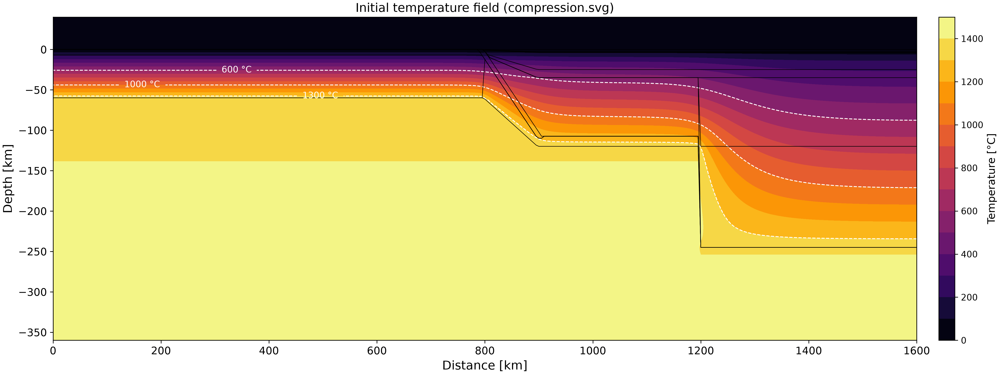
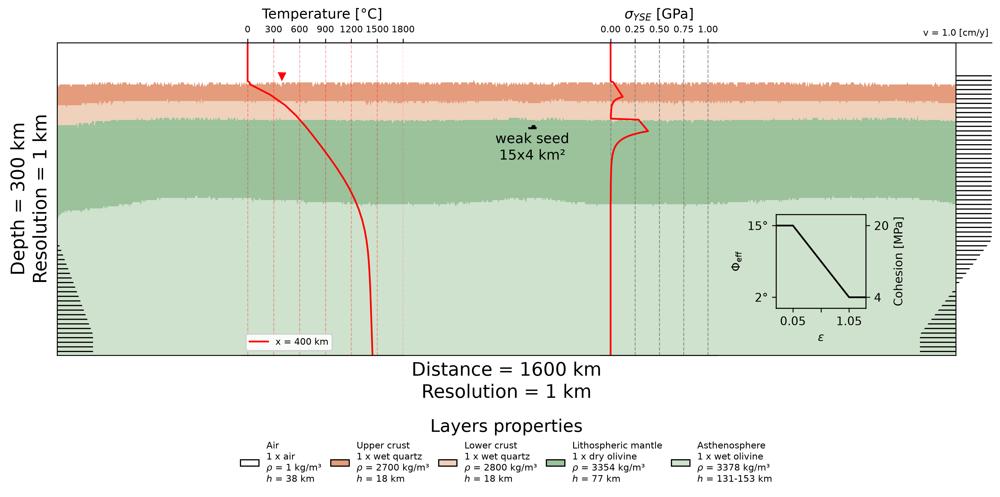

# Introdução

## O que é o tapIOca

O tapIOca (pacote `tapioca-mandyoc`) é um conjunto de ferramentas em Python para preparar e analisar modelos do [Mandyoc](https://github.com/ggciag/mandyoc), o código de elementos finitos que simula a evolução termomecânica da litosfera e do manto. Ele cobre as duas pontas de um modelo:

- **antes da rodada**: cria os arquivos de entrada do Mandyoc (`interfaces.txt`, `param.txt`, `input_temperature_0.txt`, `input_velocity_0.txt` e os arquivos com condições que mudam no tempo), a partir de um script em Python ou de um cenário desenhado num arquivo SVG;
- **depois da rodada**: converte as saídas em arquivos NetCDF e as organiza numa estrutura de dados navegável (`xarray.DataTree`), com funções de pós-processamento, como o tensor de tensões desviadoras e a seleção de partículas.

O tapIOca é a ligação entre o desenho de um cenário e as figuras finais. O mesmo cenário pode ser rodado no Mandyoc em C++ ou no mandyocjll, o porte do Mandyoc para Julia: os arquivos de entrada são os mesmos.

## As partes do pacote

| Parte | O que faz |
|---|---|
| `tapioca.inputs` | construtores genéricos: geometria, materiais, temperatura, velocidade e condições no tempo |
| `tapioca.inputs.svg` | cenários desenhados em SVG (Inkscape) e as ferramentas `tapioca-svg`, `tapioca-svg-interfaces` e `tapioca-svg-from-state` |
| `tapioca.scenClasses` | `MandyocScen`: leitura das saídas (`.nc`) num `DataTree` |
| `tapioca.post_processing` | o acessor `postproc` do `DataTree`, com cálculos sobre os resultados |
| `src/postrunning` | scripts que organizam as saídas e as convertem em NetCDF (Julia e Python) |
| `examples/` | cenários SVG de exemplo, os exemplos clássicos do Mandyoc em SVG e um cenário já rodado |

## Como ler esta apostila

Os capítulos 2 a 4 explicam a instalação, o fluxo de trabalho e as convenções, e servem para todos. O capítulo 5 ensina a desenhar e gerar um cenário SVG, e o capítulo 6 mostra como isso funciona por dentro. O capítulo 7 trata dos construtores genéricos, usados em scripts. Os capítulos 8 e 9 cobrem a execução e o pós-processamento. O capítulo 10 é o guia para quem vai modificar o código.

# Instalação

Os cenários SVG e os scripts de execução estão no fork [jopmas/tapioca](https://github.com/jopmas/tapioca), branch `feat/svg-scenario-inputs`, que ainda não foi incorporado ao [ggciag/tapioca](https://github.com/ggciag/tapioca):

```bash
git clone -b feat/svg-scenario-inputs https://github.com/jopmas/tapioca.git ~/opt/tapioca
cd ~/opt/tapioca
conda env create -f environment.yml -y     # ambiente "tapioca", com versões fixas
conda activate tapioca
pip install -e ".[test]"
pytest                                       # cerca de 30 s
```

O `environment.yml` fixa as versões das bibliotecas, para que uma versão nova de uma delas não mude os resultados. Ele também traz o PETSc e o OpenMPI, para compilar e rodar o Mandyoc no mesmo ambiente, e o `poppler` e o `pypdf`, para ler relatórios em PDF.

Os cenários SVG são lidos como **SVG 1.1 salvo pelo Inkscape 1.4**. O Inkscape não é instalado pelo `environment.yml`: instale-o de [inkscape.org](https://inkscape.org). Um arquivo de outra versão é lido com um aviso.

Os scripts de execução gerados pelo tapIOca procuram o tapIOca em `~/opt/tapioca` e os scripts de figuras do grupo em `~/opt/post_processing` (variáveis `TAPIOCA_DIR` e `POST_PROCESSING_DIR`).

# O fluxo de trabalho

Um cenário passa pelas etapas abaixo. As caixas tracejadas são opcionais.

```latex
\begin{center}
\begin{tikzpicture}[node distance=4.5mm, every node/.style={font=\small},
  box/.style={draw, rounded corners, fill=blue!6, minimum width=9.6cm, minimum height=7mm, align=center},
  opt/.style={draw, rounded corners, dashed, fill=orange!8, minimum width=9.6cm, minimum height=7mm, align=center}]
\node[box] (a) {desenho do cenário no Inkscape (\texttt{cenario.svg}) \quad ou \quad script com os construtores genéricos};
\node[box, below=of a] (b) {\texttt{tapioca-svg}: entradas do Mandyoc, figuras do cenário e script de execução};
\node[box, below=of b] (c) {execução: Mandyoc (C++) ou mandyocjll (Julia), no computador ou no Hypatia};
\node[box, below=of c] (d) {saídas em arquivos de texto (Mandyoc) ou zarr (mandyocjll e Mandyoc com \texttt{zarr\_output})};
\node[box, below=of d] (e) {\texttt{src/postrunning}: arquivos \texttt{.nc} (\texttt{meshes2netcdf.jl}, \texttt{zarr2netcdf.py})};
\node[opt, below=of e] (f) {snapshots e vídeo (\texttt{post\_processing}) e zip do cenário};
\node[box, below=of f] (g) {\texttt{MandyocScen}: \texttt{DataTree} com malhas, superfície e partículas; \texttt{postproc}};
\foreach \u/\v in {a/b,b/c,c/d,d/e,e/f,f/g} \draw[-{Stealth}] (\u) -- (\v);
\end{tikzpicture}
\end{center}
```

O script de execução gerado pelo `tapioca-svg` faz as etapas da execução em diante sozinho: roda o código, converte as saídas, faz as figuras e compacta o cenário.

# Convenções

- **Malha**: $z$ é positivo para cima, de $-L_z$ na base a 0 no topo; o nó $(i, j) = (0, 0)$ é o canto inferior esquerdo. O leitor de SVG trabalha com profundidades positivas para baixo (como o desenho) e converte em `layers_to_builder`.
- **Interfaces**: a interface `i` é o topo da camada `i` e carrega o material dela; a ID `-1` é a camada do topo (o ar adesivo, *sticky air*).
- **Materiais**: o `interfaces.txt` tem 13 parâmetros por camada: `C` (fator de escala da viscosidade), `rho` (densidade), `H` (calor radiogênico, W/kg), `A`, `n`, `Q`, `V` (lei de fluência), `k` (difusividade), `weakening_seed`, `cohesion_min`, `cohesion_max`, `friction_angle_min` e `friction_angle_max`. Os materiais de referência estão em `tapioca.DEFAULT_MATERIALS`: `wet olivine`, `dry olivine`, `wet quartz`, `wet anorthite`, `linear salt`, `dry quartz`, `basalt`, `plagioclase` e `air`.
- **Zona fraca**: a camada da semente fraca tem `weakening_seed = 1`; as outras, `-1`.
- **Unidades**: `SEC_PER_YEAR` usa 365,25 dias. As configurações aceitam unidades (km ou m; Myr, kyr ou yr; cm/yr ou mm/yr; °C), definidas em `tapioca.UNITS`.
- **Temperatura inicial**: condução estacionária na litosfera, com a base da litosfera (LAB) a 1350 °C e a adiabática do manto abaixo dela.
- **Camadas de água e de magma**: são escolhidas pelo usuário (`water_layer`, `magmatic_layer`), nunca adivinhadas pela posição.

# Cenários desenhados em SVG

## A ideia

Um cenário é desenhado como um corte vertical da litosfera, no Inkscape. Cada forma preenchida é um corpo de rocha; as propriedades do objeto (rótulo, título e descrição) dizem qual é o material. Uma forma especial, o `setup`, diz o tamanho do domínio, a resolução e o experimento numérico. O `tapioca-svg` lê o desenho e cria todas as entradas do Mandyoc:

```bash
tapioca-svg cenario.svg -o meu_cenario
```

ou, em Python:

```python
from tapioca.inputs.svg import SVGScenario
SVGScenario("cenario.svg").write_all("meu_cenario")
```


## Unidades de rocha

Cada forma preenchida é descrita pelas propriedades de objeto do Inkscape (*Objeto > Propriedades do objeto*):

- **Rótulo** (*label*): nome da unidade. Formas com o mesmo rótulo são a mesma unidade.
- **Título** (*title*): nome da unidade na legenda das figuras (opcional).
- **Descrição** (*description*): na primeira linha, o material de referência; nas seguintes, as propriedades:

```
wet quartz
C = 1.0
rho = 2800.0
H = 0.19e-6 / 2800.0
h = 10 km
```

`C`, `rho` e `H` são obrigatórios. Os outros parâmetros (`A`, `n`, `Q`, `V`, `k`, `weakening_seed`, coesão e atrito) são opcionais e, quando faltam, vêm do material de referência. Uma forma sem descrição herda a do grupo que a contém (por exemplo, uma camada do Inkscape); formas sem nenhuma descrição (setas, anotações) são ignoradas. A cor de preenchimento é usada nas figuras.

As formas são pintadas na ordem do documento, como o Inkscape as mostra: um jeito simples de desenhar é um retângulo de astenosfera cobrindo todo o domínio e as outras unidades por cima. Dois rótulos são especiais: `asthenosphere` (a unidade de baixo) e `weak_seed` (zonas fracas, com deformação inicial 1). A unidade do topo deve ser o ar adesivo.

Pontos não cobertos por nenhuma forma (frestas finas, formas que não chegam à borda) recebem a unidade do ponto coberto mais próximo, com um aviso. Camadas muito finas deixadas por formas que se sobrepõem (mais finas que `min_thickness`, 1 km por padrão) são removidas, também com aviso.

## Espessura das unidades (`h`)

O desenho não precisa estar em escala vertical: `h` dá a espessura de referência de uma unidade.

- **Camadas** (unidades que vão de um lado ao outro do domínio): a espessura desenhada mais comum vira `h`, e o mesmo fator vale em todas as colunas, então as regiões afinadas mantêm a proporção desenhada.
- **Corpos** (sementes, bacias, quilhas): sem `h`, seguem a escala da unidade onde foram desenhados; com `h`, ganham essa espessura, e a unidade em volta absorve a diferença.
- A **unidade de baixo** (astenosfera) preenche o resto do domínio e não pode ter `h`.

## O domínio e o experimento numérico

A forma com rótulo `setup` (por exemplo, um retângulo sem preenchimento) define o domínio: sua caixa é mapeada no domínio, e sua descrição dá as dimensões, a resolução e o experimento:

```
Lx = 1600 km
Lz = 300 km
dx = 2 km
dz = 2 km
regime = rifting
velocity = 1 cm/yr
moving_boundary = right
time_max = 60 Myr
magmatism = off
code = mandyoc
```

Toda configuração também pode ser dada na linha de comando (por exemplo `--regime`, `--dx`) ou como argumento de `SVGScenario`, e nesse caso substitui a do SVG. As principais:

| Configuração | Padrão | |
|---|---|---|
| `regime` | `rifting` | `rifting` (extensão), `compression`, `accordion` ou `quiescence` |
| `velocity` | 1 cm/yr | velocidade da borda móvel (com `symmetric`, a soma das duas bordas) |
| `moving_boundary` | `right` | `left`, `right` ou `symmetric` |
| `time_max` | 60 Myr | duração da simulação |
| `quiescence_time` | 0 Myr | regimes `accordion` e `quiescence` |
| `magmatism`, `magmatism_extraction`, `magmatism_Ts0` | `off`, `off`, 1080 °C | fusão no Mandyoc e extração do magma |
| `heat_capacity`, `thermal_expansion_coefficient`, `gravity_acceleration` | 1250, 3,28e-5, 10 | usados no `param.txt` e na temperatura inicial |
| `water_layer`, `magmatic_layer` | nenhuma, basalto no topo | camadas de água e de magma (rótulo ou ID) |
| `preset_initial_temperature`, `preset_temperature_mode` | nenhuma, `profile` | temperatura de um cenário preliminar |
| `custom_veloc_field` | nenhum | script em Python que constrói a velocidade |
| `custom_temp_field` | nenhum | script em Python que altera a temperatura inicial (pluma, base quente, ...) |
| `temperature_solver` | `2D` | `2D` (toda a litosfera) ou `columns` (cada coluna) |
| `code` | `mandyoc` | código chamado pelo script de execução: `mandyoc` ou `mandyocjll` |
| `min_thickness`, `sampling` | 1 km, 100 m | camadas finas removidas; amostragem vertical do desenho |

Chaves do `param.txt` do Mandyoc que não são configurações do experimento (por exemplo `particles_per_element`) também podem ir na descrição do `setup` e são copiadas para o `param.txt`. Configurações desconhecidas e valores inválidos são erros (`SVGInputError`), com uma mensagem que diz qual é o problema.

## Os regimes

- **rifting**: a borda móvel se afasta com `velocity`; a velocidade é constante da superfície até 20 km abaixo da litosfera mais espessa, e um fluxo de retorno abaixo dela equilibra a entrada e a saída de material.
- **compression**: a borda móvel avança; a velocidade é constante até 20 km abaixo da litosfera na borda móvel, e a borda oposta fica parada.
- **accordion**: extensão até 25 Myr, convergência até 75 Myr, quiescência por `quiescence_time` e extensão de novo (`scale_bcv.txt`), como nos experimentos M300.
- **quiescence**: bordas paradas, para estudar a evolução térmica.

Com `moving_boundary = symmetric`, as duas bordas se movem com metade da velocidade, cada uma com seu fluxo de retorno.





## Velocidade própria

`custom_veloc_field` aponta para um script em Python que define `build_velocity(scenario)`: ele monta as velocidades nas bordas com um `VelocityFieldBuilder` e o devolve. O script tem acesso ao `SVGScenario` inteiro (regime, velocidade, superfície, espessura da litosfera). O fluxo líquido pelas bordas deve ser nulo (por exemplo, com `conservate_veloc`); caso contrário, o tapIOca avisa.

## Temperatura inicial

Sem `preset_initial_temperature`, a temperatura inicial é a condução estacionária na litosfera, de 0 °C na superfície a 1350 °C na LAB, com a condutividade e o calor radiogênico de cada unidade, e a adiabática do manto abaixo da LAB. Com `temperature_solver = 2D` (padrão), toda a litosfera é resolvida de uma vez, então o calor também flui na horizontal onde a litosfera muda de espessura.

Com `preset_initial_temperature` (a pasta de um cenário preliminar), a temperatura inicial vem do estado final desse cenário:

- `preset_temperature_mode = profile` (padrão): a média horizontal da temperatura final, adaptada à litosfera de cada coluna do cenário novo;
- `preset_temperature_mode = field`: o campo 2D da temperatura final, interpolado na malha (o domínio deve ser o mesmo).


## Temperatura própria

`custom_temp_field` aponta para um script em Python que define `build_temperature(scenario)` (na linha de comando, `--custom-temp-field`). O script recebe o cenário com a temperatura inicial já calculada (condução, preset ou isotérmica) em `scenario.temperature_builder`, altera essa temperatura e devolve o construtor. Como no `custom_veloc_field`, `infos(scenario)` e `write_files(scenario, output_dir)` são opcionais, e o script é copiado para a pasta do cenário e entra no `inputs_<pasta>.zip`. Os dois scripts podem ser usados juntos.

O `TemperatureFieldBuilder` tem três métodos para as anomalias mais comuns (z positivo para cima: `-Lz` na base e 0 no topo do domínio). Nenhum deles altera o sticky air:

| Método | Anomalia |
|---|---|
| `add_thermal_anomaly(dT, x0, z0, rx, rz=None)` | elipse centrada em (x0, z0), por exemplo um bloco quente ou frio |
| `add_plume(dT, x0, z_head, head_radius, head_rz=None, tail_radius=None, z_base=None)` | cabeça centrada em (x0, z_head) e conduto de `z_base` (padrão: a base) até a cabeça |
| `add_basal_anomaly(dT, thickness, x0=None, width=None)` | camada quente (ou fria) na base, ao longo de toda a base ou em volta de x0 |

Todos aceitam `shape` (`gaussian`, o padrão; `cosine`, que zera fora dos raios; ou `tophat`, de bordas abruptas) e `mode` (`add` soma `dT`; `set` leva a anomalia à temperatura `dT`). O Mandyoc costuma manter a temperatura da base no valor inicial, então uma anomalia basal continua aquecendo o manto por baixo durante a rodada.

O exemplo `plume` (`examples/svg_scenarios/plume/build_temp.py`) põe uma pluma 250 °C mais quente que o manto no centro do domínio:

```python
def build_temperature(scenario):
    t = scenario.temperature_builder                     # temperatura já calculada
    z_surface = -float(scenario.thickness_sa.max())      # base do sticky air (z positivo para cima)
    t.add_plume(250.0, x0=scenario.Lx / 2, z_head=z_surface - 300e3,
                head_radius=80e3, tail_radius=25e3)
    return t

def infos(scenario):                                     # opcional: linhas do infos_<pasta>.txt
    return ["pluma no centro do domínio"]
```


## Sedimentação, água e magma

Com `sp_surface_processes = True` e um modo de sedimentação (`sp_mode = theunissen_sedimentation` ou `sedimentation_rate_limited`), o tapIOca acrescenta uma camada de sedimentos de espessura nula para cada intervalo `dt_sed` entre `ti_sed` e `tf_sed`, e escreve `sediment_layers.txt`, `sedimentation_rate.txt` e `base_level.txt` (ou `SP_vc.txt`, com `--sp-format SP_vc`). Os sedimentos, a água e o basalto extrusivo são desenhados uma vez, como moldes abaixo do domínio: suas formas só dão o material das camadas.


`water_layer` indica a unidade desenhada como água, logo abaixo do ar. Com `magmatism` e `magmatism_extraction` ligados, uma camada de basalto de espessura nula é acrescentada no topo das camadas sólidas, a menos que `magmatic_layer` indique outra.

## Os exemplos

Os exemplos estão em `examples/svg_scenarios` (um por experimento) e `examples/classical_examples` (os exemplos do Mandyoc desenhados em SVG):

| Pasta | Cenário | Experimento |
|---|---|---|
| `rifting` | litosfera continental de 155 km com semente fraca | rifting, 1 cm/yr, magmatismo |
| `rifting_symmetric` | a mesma, com a semente no centro | rifting simétrico |
| `rifting_with_basin` | litosfera afinada sob uma bacia sedimentar | rifting, 1 cm/yr |
| `compression` | litosfera oceânica, margem, litosfera não cratônica e cráton | compressão, 1 cm/yr |
| `accordion` | litosfera não cratônica entre dois crátons | accordion |
| `quiescence` | quilha cratônica num domínio de 4000 km | quiescência, 1000 Myr |
| `rifting_sedimentation` | crosta mais espessa no centro | rifting simétrico com sedimentação |
| `plume` | litosfera continental de 155 km sobre uma pluma, num domínio de 700 km de profundidade | quiescência, 50 Myr, pluma de `build_temp.py` (`custom_temp_field`) |

```bash
cd examples/svg_scenarios/rifting
tapioca-svg rifting.svg -o inputs                         # resolução do SVG
tapioca-svg rifting.svg -o inputs --dx 5 --dz 5           # malha mais grossa, para testar
```


## Recomeçar do estado final de uma simulação

`tapioca-svg-from-state` transforma o estado final de um cenário já rodado (`lithology.nc`, `temperature.nc` e `interfaces.txt`) num SVG novo: a litologia é rasterizada e cada unidade vira um caminho do SVG, com os parâmetros na descrição. O `setup` do SVG novo aponta para a temperatura do mesmo estado (`preset_temperature_mode = field`):

```bash
tapioca-svg-from-state caminho/do/cenario -o estado_final.svg
tapioca-svg estado_final.svg -o entradas
```

O SVG pode ser editado no Inkscape antes de gerar o cenário novo (por exemplo, para trocar o regime ou acrescentar uma unidade). A deformação acumulada e a fusão do estado não são mantidas.




## Só as interfaces

```bash
tapioca-svg-interfaces cenario.svg -o interfaces.txt --plot camadas.png
```

gera apenas o `interfaces.txt` e uma figura das camadas, útil para conferir um desenho.

# Como o tapioca-svg funciona

## Classes

`SVGScenario` (`inputs/svg/scenario.py`) lê as configurações (argumento > SVG > padrão), escolhe as camadas de água e de magma e conduz os construtores genéricos. O leitor (`inputs/svg/reader.py`) é um módulo de funções que transforma o desenho numa pilha de camadas (`MandyocLayer`, com o material num `LithologicalUnit`, em `inputs/svg/materials.py`). As verificações estão em `SVGChecks` (`inputs/checks.py`), que levanta `SVGInputError` com uma mensagem que nomeia o parâmetro.

| Classe ou módulo | Papel |
|---|---|
| `SVGScenario` | configurações, camadas especiais, temperatura, velocidade e escrita dos arquivos |
| `reader` | do desenho para a pilha de camadas |
| `MandyocLayer`, `LithologicalUnit` | uma camada da pilha e o seu material |
| `SVGChecks` | verificações das configurações e do desenho |
| `MandyocBuilder` | interfaces, campos de materiais, `param.txt` e exportação dos arquivos |
| `TemperatureFieldBuilder` | temperatura inicial (`solve_heat_2D`, `solve_heat_1D`) |
| `VelocityFieldBuilder` | velocidades nas bordas (`set_kinematic_regime`, `conservate_veloc`) |

## Do desenho para a pilha de camadas

1. **Formas para pontos de amostragem** (`read_units`, `rasterize`): as propriedades de cada forma são lidas, a caixa do `setup` é mapeada no domínio e o desenho é amostrado em `Nx` colunas e linhas de 100 m, pintando as formas na ordem do documento.
2. **Frestas e camadas finas** (`fill_gaps`, `remove_slivers`): pontos sem forma recebem a unidade mais próxima, e camadas finas deixadas por sobreposições são removidas.
3. **Colunas para uma pilha** (`build_stack`): cada interface do Mandyoc é uma única linha $z(x)$, então uma única sequência de camadas deve servir a todas as colunas. As sequências das colunas são unidas pela menor supersequência comum: por exemplo, `[astenosfera, manto, crosta, ar]` e `[astenosfera, manto, crosta, semente, crosta, ar]` dão a segunda, com espessura nula para a semente e para a fatia de crosta superior onde elas não existem.
4. **Espessuras** (`rescale_thickness`): cada unidade com `h` é esticada para ter essa espessura; corpos sem `h` seguem a unidade onde estão.
5. **Pilha para os construtores** (`layers_to_builder`): as interfaces do `MandyocBuilder` são criadas, os campos dos materiais são preenchidos, e os construtores de temperatura e de velocidade acrescentam os seus campos.

A superfície é o topo das camadas sólidas (a base do ar, ou da água). A LAB é achada coluna a coluna: descendo da superfície, o topo da primeira fatia de astenosfera com alguma espessura.

# Construtores genéricos

Os construtores de `tapioca.inputs` podem ser usados diretamente num script, sem SVG. O exemplo abaixo (`docs/handbook/scripts/build_scenario_example.py`, testado com o mandyocjll) monta uma litosfera com três camadas, mais fina à direita, resolve a temperatura inicial e aplica um regime de extensão:

```python
import numpy as np
from tapioca.inputs import MandyocBuilder, TemperatureFieldBuilder, VelocityFieldBuilder
from tapioca.inputs.svg import AIR, WET_OLIVINE, DRY_OLIVINE, WET_QUARTZ
from tapioca._aux_functions import read_params

Lx, Lz, Nx, Nz = 1000e3, 300e3, 201, 61                  # 5 km x 5 km
b = MandyocBuilder("my_scenario", Nx=Nx, Nz=Nz, Lx=Lx, Lz=Lz, verbose=False)
# interface i = topo da camada i (z positivo para cima, 0 no topo); -1 é o ar
b.create_interface(-1, 0.0, "air", **AIR.params)
b.create_interface(0, np.where(b.x < Lx / 2, -200e3, -160e3), "asthenosphere", **WET_OLIVINE.params)
b.create_interface(1, -75e3, "mantle", **DRY_OLIVINE.params)
b.create_interface(2, -40e3, "crust", **{**WET_QUARTZ.params, "H": 9e-10})
b.create_materials_fields()

T = TemperatureFieldBuilder(b, LAB_interface=0, surface_interface=2)   # LAB: topo da astenosfera
T.apply_linear_temperature(t_pot=1350.0)
T.solve_heat_2D()                                        # condução estacionária na litosfera
b.create_temperature_field(T)

v = VelocityFieldBuilder(b, units="cm/y")
v.set_kinematic_regime("extension", 1.0, moving_boundary="right", h_const=220e3, surface=2)
b.create_velocity_field(v)

b.export_interfaces(export="none")
params = read_params("template/param.txt")               # um param.txt do tapioca-svg, com todas as chaves
params.update(step_max=5000, time_max=20.0e6, step_print=50)
b.set_params(**params)                                   # nx, nz, lx, lz e n_interfaces vêm do construtor
b.export_params()
b.export_field("temperature", header="T1\nT2\nT3\nT4")
b.export_field("velocity", header="v1\nv2\nv3\nv4")
```

Dois cuidados, verificados ao preparar esta apostila: o `set_params` escreve só as chaves recebidas (sem os padrões do Mandyoc), por isso o exemplo parte de um `param.txt` modelo, gerado pelo `tapioca-svg`; e cada chamada de `set_params` recomeça os parâmetros do zero, com o arquivo tendo precedência sobre os argumentos, por isso as mudanças são feitas no dicionário antes de uma única chamada.

**Condições no tempo.** `GenericTimeConditions` guarda as condições que mudam no tempo (`scale_bcv.txt`, `multi_veloc.txt`, `sedimentation_rate.txt`, ...) como uma tabela, e `MandyocBuilder.set_time_conditions` as coloca no construtor:

```python
b.set_time_conditions("scale_bcv", {25.0: -1.0, 75.0: 0.01})      # tempo [Myr]: fator
b.set_time_conditions("sedimentation_rate", {0.0: 25.0, 20.0: 50.0})
b.export_time_conditions()
```

**A partir de um SVG.** Os mesmos construtores estão dentro de um `SVGScenario` e podem ser alterados antes da escrita:

```python
scenario = SVGScenario("rifting.svg")
scenario.build_temperature()
scenario.build_velocity()
scenario.velocity_builder.set_region("top", [700e3, 900e3], vz=1.0e-11, mode="add")   # m/s
scenario.builder.create_velocity_field(scenario.velocity_builder)
scenario.write_all("meu_cenario")
```

# Executar o cenário

O `tapioca-svg` escreve, junto com as entradas, o script de execução do sistema escolhido (`--system`):

| Script | Onde |
|---|---|
| `run_linux.sh` | Linux, com o `mpirun` do PETSc (`PETSC_DIR`, `PETSC_ARCH`) |
| `run_mac.sh` | macOS; o `caffeinate` mantém o computador acordado |
| `run_hypatia.sh` | job do SLURM no Hypatia (`sbatch run_hypatia.sh`) |

```bash
tapioca-svg rifting.svg -o rifting --system linux --ncores 20 \
    --mandyoc-options="-seed 0,5,8 -strain_seed 0.0,1.0,1.0"
tapioca-svg rifting.svg -o rifting --system hypatia --mail-user nome@usp.br
```

Cada processo MPI usa uma thread de OpenMP (`OMP_NUM_THREADS=1`), porque com o PETSc da conda mais threads deixam a rodada várias vezes mais lenta. Depois da rodada, o script:

1. organiza as saídas em texto (`0_organize_outputs.sh`) e cria os `.nc` com `meshes2netcdf.jl` e `particles2netcdf.jl`; com saídas zarr, usa `zarr2netcdf.py`;
2. faz os snapshots e o vídeo com os scripts de `post_processing`, se houver `lithology.nc`;
3. compacta as entradas e as saídas com `zipper.sh`;
4. apaga as pastas das saídas em texto, só se o zip estiver íntegro e completo.

`--no-post-processing` escreve o script sem essas etapas.

**Com o mandyocjll.** `code = mandyocjll` no `setup` (ou `--code mandyocjll`) faz o script chamar o mandyocjll, com as mesmas entradas. As saídas já são zarr, convertidas em `.nc` pelo `tools/zarr2nc.py` do mandyocjll. No Hypatia, o lançamento é `mpirun -n N --map-by :OVERSUBSCRIBE mandyocjll`. O tapIOca avisa quando o cenário usa uma opção que o mandyocjll não tem (hoje, só o RK4).

# Pós-processamento

## Das saídas para o NetCDF

As saídas em texto do Mandyoc (um arquivo por variável e por passo) são organizadas e convertidas:

```bash
bash ~/opt/tapioca/src/postrunning/0_organize_outputs.sh
julia -t 8 ~/opt/tapioca/src/postrunning/meshes2netcdf.jl caminho/do/cenario
julia -t 8 ~/opt/tapioca/src/postrunning/particles2netcdf.jl caminho/do/cenario PASSO_DE_REFERENCIA
```

Cada variável vira um `.nc` com as dimensões `(time, z, x)`; as partículas viram trajetórias com as dimensões `(time, id)`. O `README.md` de `src/postrunning` explica como estimar a memória e dividir a conversão em blocos (`CHUNKS`). Saídas zarr (do mandyocjll ou do Mandyoc com `zarr_output = True`) são convertidas com `src/postrunning/zarr2netcdf.py`, ou lidas diretamente com `xarray.open_zarr`.

## MandyocScen

`MandyocScen` lê o cenário num `xarray.DataTree`:

```python
from tapioca.scenClasses import MandyocScen
import tapioca.post_processing                # registra o acessor postproc

scen = MandyocScen("caminho/do/cenario", variables=["density", "temperature", "viscosity", "velocity"],
                   load_lithology=True, load_surface=True, load_particles=False)
print(scen.DTree)                              # /mesh/original, /mesh/upscaled, /surface, /particles
mesh = scen.DTree["/mesh/original"].ds         # density, temperature, viscosity, vx, vz
mesh.temperature.sel(time=5, method="nearest").plot()
scen.params["nx"]                              # o param.txt, como dicionário
```

| Nó do `DataTree` | Conteúdo |
|---|---|
| `/mesh/original` | as variáveis da malha, com as dimensões `(time, z, x)` |
| `/mesh/upscaled` | a litologia, numa malha 5 vezes mais fina |
| `/surface/topography` | a superfície (topografia) ao longo de $x$ |
| `/particles` | as trajetórias das partículas, com seleção por tempo, coordenadas ou litologia |

Os métodos `selectParticles_bytimerange`, `selectParticles_bycoords` e `selectParticles_bylithology` selecionam partículas, e `fieldToParticle` interpola um campo da malha nas partículas selecionadas (útil para trajetórias de pressão e temperatura).

## O acessor postproc

O acessor `postproc` calcula grandezas sobre o `DataTree`. O tensor de tensões desviadoras de um fluido incompressível:

```python
scen.DTree.postproc.DeviatoricStressTensor()   # tau_xx, tau_zz, tau_xz e tau_J2 em /mesh/original
```

`tau_J2` $= \tfrac12(\tau_{xx}^2 + \tau_{zz}^2) + \tau_{xz}^2$ é o segundo invariante; ele tem a unidade da tensão ao quadrado (MPa²), embora o atributo `units` diga MPa. Para uma tensão em MPa, use $\sqrt{J_2}$.


# Guia para desenvolvedores

## Organização do código

| Caminho | |
|---|---|
| `src/tapioca/scenClasses.py` | `MandyocScen` |
| `src/tapioca/_variables.py` | constantes (`SEC_PER_YEAR`, `UNITS`), materiais (`DEFAULT_MATERIALS`), tipos do `param.txt` (`PARAMS_TYPES`) |
| `src/tapioca/_aux_functions.py` | funções auxiliares: leitores, unidades, solvers de calor, envoltória de resistência, temperatura preliminar |
| `src/tapioca/post_processing.py`, `mandyocPlotter.py` | pós-processamento e gráficos |
| `src/tapioca/inputs/generic_input_classes.py` | `MandyocBuilder`, `TemperatureFieldBuilder`, `VelocityFieldBuilder`, `GenericTimeConditions` |
| `src/tapioca/inputs/checks.py` | `InputChecks`, `SVGChecks` e os erros |
| `src/tapioca/inputs/svg/` | `reader`, `materials`, `scenario`, `cli`, `from_state`, `_variables` (regimes, padrões do `param.txt`, scripts de execução) |
| `src/postrunning/` | scripts de organização e conversão das saídas |
| `tests/` | testes do pytest |
| `docs/` | documentação (Sphinx) e esta apostila (`docs/handbook`) |

## Convenções

- Código, docstrings, commits e documentação em inglês (esta apostila tem uma versão em português).
- O código específico de SVG fica em `inputs/svg`, não nos construtores genéricos; funções auxiliares genéricas vão para `_aux_functions.py`.
- Vários branches mexem ao mesmo tempo nos arquivos centrais (`_aux_functions.py`, `_variables.py`, `mandyocPlotter.py`, `post_processing.py`, `scenClasses.py`, `inputs/generic_input_classes.py`): mantenha as mudanças neles mínimas, prefira acrescentar funções a reescrever, e simule o merge antes de um commit (`git merge-tree --write-tree HEAD origin/<branch>`).
- Problemas encontrados fora do código de SVG são marcados com comentários `## BUG (Claude)` ou `## NOTE (Claude)`, para o responsável pelas classes genéricas avaliar; uma correção de que o código de SVG precisa é marcada `## FIX (Claude)`.

## Testes

```bash
pytest                       # toda a suíte, cerca de 30 s
pytest tests/test_svg_scenario.py -k compression
```

Os testes cobrem as variáveis e as funções auxiliares, os materiais, os construtores genéricos, as verificações, os cenários SVG dos exemplos (em malha grossa), as ferramentas de linha de comando e o pós-processamento de `examples/continental_rift`. Rode-os antes de um pull request e acrescente testes para as funções novas.

## Roteiros

- **Um material novo**: acrescente-o a `DEFAULT_MATERIALS` (`_variables.py`); ele fica disponível nas descrições do SVG pelo nome.
- **Uma configuração nova do SVG**: acrescente a chave a `EXPERIMENT_KEYS` (`inputs/svg/reader.py`) e como argumento de `SVGScenario.__init__`, verifique o valor em `SVGChecks`, use-o em `SVGScenario` e acrescente a opção em `inputs/svg/cli.py`; os valores fixos (como os regimes) ficam em `inputs/svg/_variables.py`. Escreva um teste e documente em `docs/source/user_guide/svg_scenarios.md`.
- **Uma chave nova do `param.txt`**: acrescente-a a `PARAMS_TYPES`, ou o `set_params` a recusa.

## Refazer esta apostila

```bash
python docs/handbook/scripts/make_figures.py PASTA_DE_TRABALHO [CENARIO_RODADO]   # figuras
python docs/handbook/build_handbook.py handbook_pt.md                            # PDF (xelatex)
python docs/handbook/build_handbook.py handbook_en.md
```

# Limitações e pendências

- O `mandyocPlotter` ainda está em construção.
- Os cenários SVG são 2D.
- O `set_params` não preenche os padrões do Mandyoc e recomeça os parâmetros a cada chamada (veja o capítulo 7).
- `tau_J2` tem unidade de tensão ao quadrado, mas o atributo diz MPa.
- A documentação de referência (Sphinx) ainda não cobre todas as funções.
